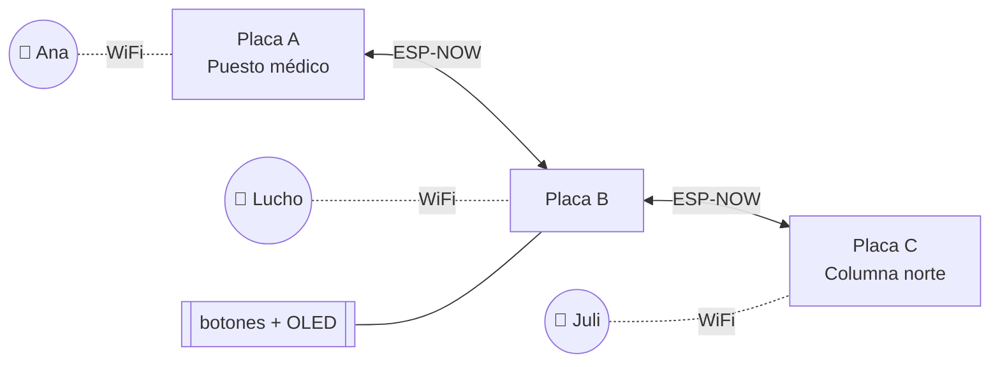

# 01 · Visión y conceptos

## El problema

En una marcha masiva, un corte de luz o una emergencia, la red celular deja de
servir justo cuando más se la necesita: las antenas se saturan con miles de
personas en pocas cuadras, o se quedan sin energía. Las necesidades en esos
momentos son pocas y concretas:

- **Avisar rápido** algo grave: "necesito un médico", "hay peligro acá", "estoy bien".
- **Coordinar** entre grupos: dónde está el puesto sanitario, quién lleva agua.
- **Hablarle a una persona** puntual, aunque ahora no esté al alcance.
- **Saber dónde está la gente** respecto de uno (y dónde hay más ruido: dónde está "lo caliente").

## La propuesta

SIGSEV es una **red mesh de placas ESP32-S3** que se arma sola, sin
infraestructura: no hay router, ni internet, ni servidor, ni cuentas. Cada placa
reenvía lo que escucha, así que el alcance de la red es el de la cadena de
placas, no el de una sola. Si una placa se apaga, los mensajes siguen por las
demás.

Sobre esa red se apoyan dos tipos de **usuarios** (clientes):

1. **El celular**, el usuario principal. Se conecta al WiFi abierto de la placa
   más cercana (`SIGSEV-XXXX`), se le abre solo un portal y desde el navegador
   manda alertas, texto y voz. No instala nada.
2. **La placa misma**, para quien no tiene celular, no quiere usarlo o se quedó
   sin batería. Con sus botones y su pantalla manda alertas y voces, las
   escucha y llama a otras placas tipo walkie-talkie. No puede escribir ni leer
   texto largo, pero participa de la red como cualquier otro usuario.

### Placas como bastión, celulares como clientes

Esta es la decisión de diseño central. Las placas son la **infraestructura**:
forman la red, guardan mensajes, los reenvían y miden distancias. Los celulares
son **clientes**: cada uno cuelga de una placa (su *padre*) y la usa como punto
de acceso a la red.

- Cada celular tiene **su propia identidad** (un ID de 32 bits que sortea y
  guarda el navegador, y un nombre). No hace falta registrarse.
- Cada uno **ve solo lo suyo**: lo que es para todos, lo que le mandaron y lo
  que mandó. Dos personas conectadas a la misma placa no ven los privados de la otra.
- Las placas **anuncian qué celulares tienen** conectados, así toda la red sabe
  de qué placa cuelga cada uno y se le puede escribir a un celular que está a
  varias placas de distancia.
- Si un celular **se pasa a otra placa** (la persona camina), sus privados pendientes lo siguen.

¿Por qué así y no "cada celular es un nodo"? Porque un celular no puede hablar
ESP-NOW ni hacer de router: el navegador solo ve HTTP. La placa tiene que ser
el intermediario, y conviene que el modelo lo diga explícitamente en vez de
fingir que la placa es el usuario.

### Mensajes privados que esperan

Un mensaje privado a alguien que **no está en la red ahora** no se pierde: las
placas que lo escucharon lo guardan **en custodia** y se lo reenvían cuando el
destino aparece (store-and-forward, como en las redes tolerantes a demoras). El
que lo mandó ve el estado:

- *en camino…*: todavía no llegó;
- **✓**: llegó a la placa de la que cuelga el destino;
- **✓✓**: el celular destino lo vio.

## ¿Por qué no LoRa?

LoRa (el ecosistema de Meshtastic, por ejemplo) es la referencia obvia de mesh
para emergencias: llega a kilómetros con muy poco consumo. No competimos en
alcance. La apuesta es otra: **una radio con cientos de veces más ancho de
banda** habilita cosas que con LoRa no se pueden hacer.

| | LoRa / Meshtastic | SIGSEV (ESP-NOW + WiFi) |
|---|---|---|
| Alcance por salto | km | ~100–200 m en línea de vista |
| Ancho de banda | ~0,3–20 kbps según configuración | 1 Mbps (tasa de ESP-NOW por defecto) |
| Latencia por salto | cientos de ms a segundos | milisegundos |
| Qué viaja | texto corto | voz, texto, alertas, topología y ruido |
| Uso desde el celular | app propia + Bluetooth | cualquier navegador, sin instalar nada |
| Hardware extra | módulo LoRa | ninguno: el WiFi ya viene en el ESP32 |
| Distancia entre nodos | no | sí, medida por WiFi (FTM) |

Un mensaje de voz de 20 s son unos 80 KB: con LoRa tardaría minutos (y en
varias regiones violaría los límites de *duty cycle*); por ESP-NOW sale en
unos 2,5 s.

En una marcha las personas están **densas**: cientos de metros de alcance por
salto alcanzan, y la densidad hace que haya muchos caminos.

## Qué se puede hacer hoy

| Función | Celular | Placa |
|---|---|---|
| Alertas (SOS, MÉDICO, PELIGRO, ESTOY BIEN) | ✔ (mantener apretado) | ✔ (KEY1–3, mantener 1 s) |
| Texto a todos o privado | ✔ | — (no hay teclado) |
| Voz a todos o privada | ✔ (grabador del sistema) | ✔ (KEY4, push-to-talk) |
| Escuchar voces | ✔ | ✔ si tiene parlante |
| Walkie por clips (audios que salen y suenan solos) | ✔ | — |
| Llamada en vivo (half-duplex) | — | ✔ entre placas |
| Mapa de la red con distancias y ruido | ✔ | lista de nodos |
| Confirmaciones ✓ / ✓✓ | ✔ | `(ok)` en la lista |

## Qué NO es

- **No es seguro.** Los privados son *dirigidos*, no cifrados: cualquier placa
  de la red puede leerlos. Tampoco hay autenticación: un celular podría decir
  que es otro. Ver [11 · Limitaciones](11-limitaciones.md).
- **No es de largo alcance.** Es una red de proximidad que crece con la densidad.
- **No es un producto terminado.** Es un prototipo de hackatón; varias partes
  están probadas en placa y otras solo compiladas (ver la lista en el documento 11).
