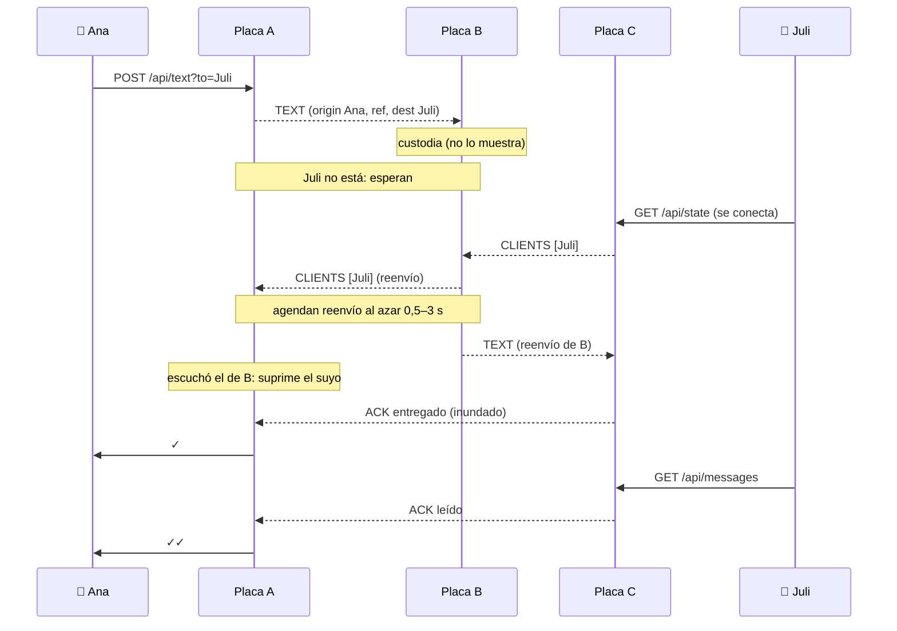
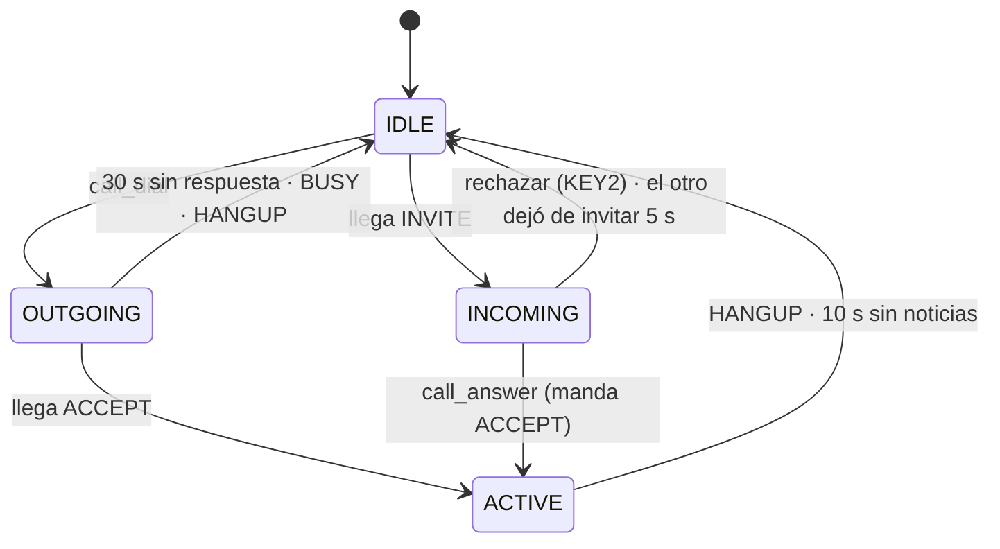

# 03 · Recorridos de punta a punta

La mejor forma de entender un sistema con muchos módulos es seguir un caso
concreto. Cada recorrido dice qué función corre, en qué archivo y en qué task.

- [A. Una alerta SOS desde la placa](#a-una-alerta-sos-desde-la-placa)
- [B. Un privado de texto a alguien que no está](#b-un-privado-de-texto-a-alguien-que-no-está)
- [C. Una voz grabada en la placa](#c-una-voz-grabada-en-la-placa)
- [D. Una foto desde el celular, con paquetes perdidos](#d-una-foto-desde-el-celular-con-paquetes-perdidos)
- [E. Una llamada entre dos placas](#e-una-llamada-entre-dos-placas)

---

## A. Una alerta SOS desde la placa

**Situación:** alguien mantiene apretada KEY1 durante un segundo.

1. **Interrupción.** El GPIO 14 pasa a 0 (los botones tienen pull-up y cierran a
   masa). Corre `button_isr` (`periph/buttons.c`), marcada `IRAM_ATTR` para
   poder correr aunque la flash esté ocupada. Deshabilita la interrupción de
   ese pin (los contactos rebotan y dispararían decenas de veces) y encola el ID
   del botón con `xQueueSendFromISR`.
2. **Debounce.** El task `buttons` saca el ID, espera 20 ms a que el contacto se
   asiente, rehabilita la interrupción, lee el nivel y publica
   `BUTTONS_EVENT_PRESSED` en el bus de eventos.
3. **Controles.** `on_button` (`main/controls.c`) ve que KEY1 es una tecla de
   alerta y arranca un `esp_timer` de 1 s. La UI también recibe el evento, pero
   ignora KEY1–4 (solo usa el joystick).
4. **¿Toque o mantenida?** Si se suelta antes del segundo, el timer sigue
   activo: es un *toque* y va a `on_tap` (llamadas, ver E). Si el timer vence
   con la tecla apretada, corre `on_hold` → `messages_send_alert(mesh_self_id(), ALERT_SOS)`.
   **Por qué mantener:** una alerta falsa en una marcha genera pánico; un roce
   del bolsillo no debe dispararla.
5. **Mensaje.** `messages_send_alert` (`messages/alerts.c`) arma
   `wire_alert_t {kind, origin}` (5 bytes), llama a `mesh_send(MESH_TYPE_ALERT, …)`
   y guarda el mensaje propio en el store (`store_add`), que publica
   `MESSAGES_EVENT_NEW`. La UI muestra el aviso "enviado".
6. **Mesh.** `mesh_send` (`mesh/mesh.c`) le pone el header de 12 bytes (TTL 6,
   saltos 0, `seq` siguiente, `origin` = ID propio) y lo deja en la cola de
   salida. El task `mesh_tx` lo saca y llama a `link->broadcast`, que es
   `esp_now_send` a `ff:ff:ff:ff:ff:ff`, y espera la confirmación de que salió al aire.
7. **Llega al vecino.** El driver WiFi del vecino llama a `on_recv`
   (`link/link_espnow.c`) → `on_link_rx` (`mesh.c`), que solo copia el frame a
   la cola de recepción: estamos en el contexto del driver y no hay que demorarlo.
8. **Procesamiento.** El task `mesh_rx` corre `handle_frame`:
   - anota al vecino que lo transmitió y su RSSI (`neighbors_heard`);
   - descarta si el origen somos nosotros;
   - descarta si `(origin, seq)` ya se vio (`dedup_check_and_add`);
   - **reenvía primero**: copia con TTL−1 y saltos+1 a la cola de salida, con
     una espera al azar de 0–8 ms antes de transmitir;
   - recién después llama al handler registrado: `on_alert`.
9. **Se muestra.** `on_alert` guarda la alerta; `MESSAGES_EVENT_NEW` llega a
   `ui/ui.c` → `on_message`, que pone un *toast* de alerta a pantalla completa
   durante 15 s. Un celular conectado a esa placa la ve en el próximo pedido
   a `/api/messages` (cada 1,5 s), con un banner y vibración.

El vecino del vecino recibe el reenvío del paso 8 y repite lo mismo. El paquete
deja de propagarse cuando el TTL llega a 1 o cuando todos ya lo vieron.

---

## B. Un privado de texto a alguien que no está

**Situación:** Ana (celu conectado a la placa A) le escribe a Juli. Juli
estaba conectada a la placa C pero ahora está fuera de alcance. Entre A y C
está la placa B.

1. **Celular.** En `app.js`, el formulario arma
   `POST /api/text?to=<id de Juli>&c=<id de Ana>` con el texto en el body y el
   header `X-Client-Name: Ana`.
2. **API.** `post_text` (`web/api.c`):
   - `client_of` lee `c`, llama a `presence_client_seen(Ana, "Ana")`, que deja a
     Ana registrada como cliente local de A, y rechaza si el ID es el de una placa;
   - `query_dest` lee `to`;
   - `messages_send_text(Ana, Juli, texto)`.
3. **Mensaje.** `messages_send_text` (`alerts.c`) verifica que Ana pueda mandar
   desde esta placa (`messages_valid_sender`), arma el mensaje con
   `origin = Ana`, un `ref` nuevo y `dest = Juli`, lo manda (`send_text_wire`) y
   lo guarda. La identidad `(origin, ref)` va **dentro del payload**, no solo en
   el header de la mesh: así otra placa puede reenviarlo más tarde con su
   propio header y todos lo reconocen como el mismo mensaje.
4. **Custodia.** B recibe el texto (`on_text`). No lo tenía (`store_find`) y no
   es para nadie de B (`messages_in_transit`): lo guarda **sin mostrarlo** y loguea
   `holding private text`. A también lo tiene (es el origen).
5. **Espera.** El courier (`messages/courier.c`, cada 250 ms) ve en A y en B un
   privado pendiente. Como Juli no está viva (`presence_is_alive`), no hace nada.
6. **Juli vuelve.** Juli se conecta a C y su celular pide `/api/state`.
   `presence_client_seen` la registra como cliente local de C y publica
   `PRESENCE_EVENT_NODE_JOINED`. Después de su próximo beacon, C manda un
   paquete `CLIENTS` con la lista de sus celus. A y B lo reciben (`on_clients`),
   ven que Juli cambió de padre (o volvió) y publican `NODE_JOINED` también.
7. **Reenvío con supresión.** En A y en B, `on_node_joined(Juli)` agenda el
   reenvío con una espera al azar de 0,5 a 3 s. Supongamos que B sortea 0,8 s y
   A 2,1 s: B reenvía primero. A escucha ese reenvío (llega como texto repetido:
   `store_find` lo encuentra → `courier_heard`), y cuando vence su espera ve que
   alguien se adelantó y **no reenvía**. Sin esto, con 30 placas custodiando,
   las 30 reenviarían a la vez.
8. **Entrega.** C recibe el texto. Ahora `messages_dest_is_here` es verdadero
   (Juli es cliente local de C): lo guarda, lo muestra y llama a `courier_ack`,
   que manda un `ACK` de tipo *entregado* por toda la red.
9. **✓.** A y B reciben el ACK (`on_ack`) y marcan el mensaje entregado: dejan
   de insistir. En A, el celu de Ana ve "✓ entregado" en el próximo refresco.
10. **✓✓.** El celular de Juli pide `/api/messages?c=Juli`. `get_messages`
    lista solo lo de Juli (`messages_list_for`) y, después de mandar la
    respuesta, marca leído cada privado para ella que llegó entero
    (`messages_mark_read`). Sale un `ACK` de tipo *leído*; A lo recibe y Ana ve "✓✓ visto".

Si en el paso 8 el ACK se pierde, C lo vuelve a mandar cada vez que escucha un
reenvío del mismo texto, y A se lo reenvía a Ana cuando Ana reaparece.

---

## C. Una voz grabada en la placa

**Situación:** en la pantalla *Red*, con un nodo marcado, alguien mantiene KEY4,
habla y suelta.

1. **Tecla.** `on_voice_key(true)` (`controls.c`): no hay llamada activa ni una
   voz marcada para escuchar, así que llama a `messages_voice_start(ui_selected_node())`.
2. **Reserva.** `messages_voice_start` (`messages/voice.c`) crea un mensaje de
   voz con el largo máximo (20 s = 364 bloques) en el store
   (`store_add_blocks`). Solo reserva la tabla de punteros a segmentos, unos
   pocos bytes: la memoria del audio se pide a medida que llega.
3. **Mic.** El task `mic` (`periph/audio.c`) lee del I2S0 en estéreo a 16 kHz
   (el mic PDM ocupa un solo canal; `pick_channel` elige el que tiene energía),
   y reparte el audio mono a sus tres suscriptores: el medidor de ruido, la
   grabación y las llamadas.
4. **Framer.** `on_mic` → `audio_framer_push`: saca la componente continua del
   PDM con un pasa-altos de un polo, baja de 16 a 8 kHz promediando de a pares y,
   cada 440 muestras (55 ms), llama a `on_frame`.
5. **Codificación.** `on_frame` guarda el estado del códec (predictor e índice)
   *antes* de codificar, codifica los 440 valores en 220 bytes de ADPCM y
   escribe el bloque en el store (`store_block_put`). Si es el primero de un
   segmento, el store reserva ahí 7 KB (32 bloques).
6. **Fin.** Al soltar, `messages_voice_stop` encola `REC_DONE`. El task `voice`
   espera 40 ms (para que termine el callback del mic en curso), descarta la
   grabación si dura menos de ~275 ms (5 bloques: un toque sin querer), recorta
   el mensaje al largo real (`store_blocks_truncate`, que libera los segmentos
   sobrantes) y lo manda.
7. **Envío.** `send_voice` manda cada bloque como un paquete `VOICE` de 238
   bytes, esperando 5 ms entre uno y otro para dejarles aire a los reenvíos de
   los vecinos. 20 s de voz salen en ~2,5 s.
8. **Recepción.** En cada placa, `on_voice` crea el mensaje con el primer bloque
   que llega (sea cual sea) y va llenando. Cuando completa, avisa
   (`MESSAGES_EVENT_UPDATED`) y, si el destino está ahí, confirma.
9. **Escuchar.** En la placa: pantalla *Mensajes*, marcar la voz y tocar KEY4
   (`messages_voice_play` → task `player`). En el celular: *▸ Escuchar* baja
   `/api/voice?id=…`, un WAV que la placa decodifica al vuelo.

**Por qué cada bloque lleva su estado del códec:** ADPCM codifica diferencias
respecto de la muestra anterior. Si un bloque se pierde, el decodificador
pierde la referencia y el resto sale distorsionado. Con el estado en cada
bloque, perder uno es un silencio de 55 ms y nada más.

---

## D. Una foto desde el celular, con paquetes perdidos

**Situación:** Lucho manda una foto de 3 MB a todos desde una placa sin PSRAM (límite 48 KB).

1. **Achicar.** `sendFile` (`app.js`) ve que es una foto más grande que el 90 %
   del límite: la dibuja en un `<canvas>` cada vez más chico (1280, 1024, 800…
   px de lado) y la recomprime a JPEG con calidad decreciente (0,8 → 0,35) hasta
   que entra. Una foto de celular suele quedar en ~40 KB a 640 px.
2. **Subida.** `POST /api/file` con el JPEG en el body, `Content-Type: image/jpeg`
   y el nombre en `X-File-Name` (URL-encoded, por los acentos).
3. **API.** `post_file` (`api.c`) valida el tamaño, crea el mensaje
   (`messages_file_begin`), lee el body de a 1 KB y lo va cortando en bloques de
   220 bytes (`messages_file_write`). Al terminar (`messages_file_end`), si
   llegó entero, encola el envío: `sender_post(id, 0, bloques, info=true)`.
4. **Envío.** El task `sender` manda primero un paquete `FILE_INFO` (nombre,
   tipo, tamaño) y después cada bloque como `FILE`, 5 ms entre uno y otro.
5. **Recepción.** `on_info` y `on_chunk` (`messages/files.c`) crean el mensaje
   con lo que llegue primero: si se perdió `FILE_INFO`, los bloques igual se
   guardan y los datos del archivo se piden después.
6. **Reparación.** Supongamos que en una placa llegaron 210 de 218 bloques. El
   task `repair` (`messages/repair.c`) revisa cada 500 ms los mensajes
   incompletos que le interesan. Si pasó 1,5 s sin bloques nuevos, arma un
   `NACK` con los rangos que faltan (`store_missing`: "40–42, 117, 201–204") y lo
   inunda.
7. **Quién contesta.** El origen (la placa de Lucho, porque Lucho es su cliente
   local) recibe el NACK (`on_nack`) y encola esos rangos en el `sender`. Si el
   origen ya no estuviera en la red, contestaría cualquier placa que tenga el
   archivo. Se reintenta hasta 6 veces seguidas sin progreso.
8. **Ver.** Cuando completa, el celular de otro usuario lo muestra: si es imagen,
   como miniatura (``); si no, con un link para bajarlo.

A una voz le faltan bloques y suena con huecos; a un archivo no le puede faltar
ninguno. El mismo mecanismo de NACK sirve para las dos cosas.

---

## E. Una llamada entre dos placas

**Situación:** en la placa X, pantalla *Red*, se marca la placa Y y se toca KEY1.

1. **Discar.** `on_tap(KEY1)` (`controls.c`) → `call_dial(Y)` (`call/call.c`):
   estado `OUTGOING`, `call_id` al azar.
2. **Timbre.** El task `call` (cada 20 ms) manda `INVITE` cada 1 s y hace sonar
   un tono suave cada 2 s. Si en 30 s nadie atiende: `NO_ANSWER`.
3. **Recibir.** En Y, `on_call` ve un `INVITE` para ella: si está libre, pasa a
   `INCOMING` y suena el timbre (880 Hz + 660 Hz). Si ya está en otra llamada,
   contesta `BUSY`. La pantalla muestra la llamada entrante.
4. **Atender.** En Y se toca KEY1 → `call_answer` → manda `ACCEPT` → `ACTIVE`.
   X recibe el `ACCEPT` y también pasa a `ACTIVE`.
5. **Hablar.** En cualquiera de las dos, mantener KEY4 → `call_talk(true)`. El
   suscriptor del mic de la llamada empieza a armar bloques de 55 ms,
   codificarlos y encolarlos; el task `call` los manda como `CALL/AUDIO` con un
   número de secuencia. La pantalla dice AL AIRE en una y ESCUCHANDO en la otra.
6. **Escuchar.** El otro lado mete cada bloque en una cola de 8 (el *jitter
   buffer*). El task `call_play` espera a tener 2 (~110 ms) antes de arrancar,
   descarta los que llegan tarde o repetidos (por secuencia), decodifica y
   manda al parlante.
7. **Mantenerse vivo.** Cada 2 s sale un `PING`. Si pasan 10 s sin escuchar al
   otro, la llamada se da por perdida (`LOST`).
8. **Cortar.** KEY1 → `call_hangup` → `HANGUP`.

Máquina de estados:

**Por qué half-duplex** (uno habla por vez): el mic está al lado del parlante.
Si los dos hablan a la vez, lo que sale del parlante entra al mic y vuelve:
acople. Cancelar eco en un microcontrolador sin DSP es un proyecto en sí mismo.
Mientras uno habla, su lado no reproduce.
