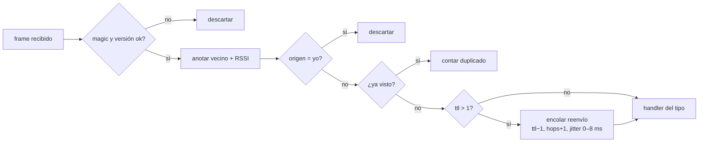

# 04 · Radio, mesh y presencia

Este documento cubre las tres capas de abajo: cómo se usa la radio WiFi
(`radio`, `link`), cómo viaja un paquete por la red (`mesh`) y cómo cada placa
sabe quién está (`presence`).

## 1. La radio: un WiFi para dos usos

El ESP32-S3 tiene **una** radio de 2,4 GHz. La usamos para dos cosas a la vez:

1. **Un punto de acceso (AP) WiFi abierto** al que se conectan los celulares
   (`SIGSEV-XXXX`, hasta 4 por placa).
2. **ESP-NOW** para hablar con las otras placas.

`radio_init` (`components/radio/radio.c`) configura:

| Parámetro | Valor | Por qué |
|---|---|---|
| Modo | `WIFI_MODE_APSTA` (o `AP` sin FTM) | La STA no se conecta a nada: solo existe para iniciar mediciones de distancia (ver [07](07-distancia.md)). |
| Canal | 6 (fijo, Kconfig) | ESP-NOW y el AP comparten radio, así que **comparten canal**. Todas las placas tienen que estar en el mismo, si no no se escuchan. Ninguna placa se asocia a otra red, así que el canal nunca se mueve. |
| Seguridad del AP | Abierto | En una emergencia, nadie debería tener que tipear una contraseña. |
| Power save | `WIFI_PS_NONE` | Con ahorro de energía la radio duerme entre beacons del AP y se pierde tráfico ESP-NOW. Gasta más batería a cambio de no perder paquetes. |
| FTM responder | sí | El AP contesta pedidos de medición de distancia de otras placas. |

### ¿Qué es ESP-NOW?

Un protocolo de Espressif que manda **frames de acción del estándar 802.11**
(frames de gestión de tipo *vendor-specific*) directamente entre dispositivos,
**sin asociarse** a una red: no hay handshake, ni DHCP, ni IP. Un frame lleva
hasta **250 bytes** de datos. Se puede mandar a una dirección puntual (con ACK
y reintentos de capa MAC) o a broadcast (`ff:ff:ff:ff:ff:ff`, sin ACK).

**Por qué ESP-NOW y no WiFi "normal" entre placas:** con WiFi tradicional una
placa tendría que ser AP y las otras asociarse: eso arma una estrella, no una
mesh, y la placa central es un punto único de falla. ESP-NOW permite que
cualquier placa le hable a cualquiera que tenga al alcance, sin estado de conexión.

**Por qué broadcast y no unicast:** en una mesh por flooding cada transmisión
tiene que llegar a *todos* los vecinos. Con unicast habría que mandar una copia
por vecino. El costo es que el broadcast **no tiene ACK ni reintentos**: si hay
una colisión, el frame se pierde sin aviso. Toda la confiabilidad está arriba
(reparación de bloques, courier, ACKs propios).

### La interfaz `link`

`components/link/link_espnow.c` implementa `link_t` sobre ESP-NOW:

- `start`: `esp_now_init`, registra los callbacks y agrega el *peer* broadcast
  en la interfaz del AP (`WIFI_IF_AP`), para que los frames salgan con la MAC
  del AP y en su canal.
- `broadcast`: `esp_now_send` y espera hasta 50 ms el callback de "salió al
  aire". Es bloqueante a propósito: el task `mesh_tx` no manda el próximo frame
  hasta que salió el anterior, así no se llena la cola interna del driver.
- `self_addr`: la MAC del softAP.

## 2. La mesh

`components/mesh/` implementa una red de **un solo nivel** sin rutas: cada
paquete llega a todos.

### Identidad

```c
typedef uint32_t mesh_node_id_t;  // últimos 4 bytes de la MAC del softAP
```

El nombre por defecto es `SIGSEV-` + los últimos 2 bytes en hexa (`SIGSEV-00D9`).
32 bits alcanzan: las MAC de Espressif son únicas y los primeros 2 bytes son el
prefijo del fabricante, que es igual en todas.

### Header (12 bytes)

```c
typedef struct __attribute__((packed)) {
    uint8_t magic;     // 0x53 'S'
    uint8_t version;   // 1
    uint8_t type;      // mesh_type_t
    uint8_t ttl;       // saltos que le quedan
    uint8_t hops;      // saltos que dio
    uint8_t reserved;
    uint16_t seq;      // secuencia del origen
    uint32_t origin;   // quién lo creó
} wire_header_t;
```

- **`magic` y `version`:** otros dispositivos pueden estar usando ESP-NOW en el
  mismo canal. Lo que no empieza con `0x53 01` se ignora.
- **`(origin, seq)` identifica un paquete** en toda la red. `seq` arranca en un
  valor al azar en cada arranque: si una placa se reinicia y arrancara en 0,
  sus vecinos todavía tendrían en el dedup los `seq` viejos y descartarían los nuevos.
- **Todo se manda como struct crudo**, sin serialización: todas las placas son
  ESP32-S3 (little endian, mismo compilador). Es frágil si se mezclaran
  arquitecturas, pero ahorra código y bytes.

Quedan 238 bytes de payload (`MESH_PAYLOAD_MAX`). Cada formato de paquete tiene
un `_Static_assert` de que entra.

### Flooding controlado

`handle_frame` (`mesh.c`), para cada frame recibido:

1. Valida `magic`/`version`.
2. Anota al vecino que lo transmitió (su MAC y RSSI): **la tabla de vecinos se
   arma escuchando pasivamente**, sin paquetes de "hola" propios.
3. Descarta los paquetes propios que vuelven rebotados.
4. Descarta duplicados (`dedup_check_and_add`).
5. **Reenvía antes de procesar**, si `ttl > 1`: copia con `ttl − 1` y `hops + 1`
   a la cola de salida. El procesamiento local (que puede tardar) no le suma
   latencia al resto de la red.
6. Llama al handler del tipo.



**Por qué flooding y no ruteo** (AODV, OLSR, BATMAN…):

- La topología de una marcha **cambia todo el tiempo**: la gente camina. Un
  protocolo de ruteo gasta tráfico en mantener rutas que se vencen en segundos.
- Muchos mensajes son **para todos** (alertas, beacons): para eso el flooding es óptimo.
- No hay estado que se corrompa: si una placa se cae, el siguiente paquete
  simplemente no pasa por ella.
- Es poco código y fácil de razonar en una hackatón.

**El costo:** cada paquete se transmite **una vez por cada placa** de la red.
Con N placas, una voz de 364 bloques genera 364·N transmisiones. Eso limita el
tamaño práctico de la red (decenas de placas, no miles). Ver [11](11-limitaciones.md).

### Las tres defensas contra la "tormenta de broadcast"

Cuando todos reenvían todo, aparecen tres problemas (Ni et al., 1999): tráfico
redundante, contención por el canal y colisiones. El código los ataca así:

| Defensa | Dónde | Qué evita |
|---|---|---|
| **Dedup** | `dedup.c` | Que un paquete se reenvíe más de una vez por nodo (y que circule para siempre). |
| **TTL = 6** | Kconfig `SIGSEV_MESH_TTL` | Que un paquete recorra más de 6 saltos (~1 km en el mejor caso). |
| **Jitter de 0–8 ms** | `tx_task` | Que todos los vecinos que escucharon el mismo paquete lo retransmitan en el mismo instante y choquen. Cada uno espera un tiempo al azar. |

Además, quien manda ráfagas (voz) espera 5 ms entre bloques para
dejar lugar a los reenvíos de los vecinos.

### Deduplicación

`dedup.c` guarda los últimos **1024** pares `(origin, seq)` en un anillo y los
busca linealmente, del más nuevo al más viejo (los duplicados llegan
enseguida, así que casi siempre se encuentran en las primeras posiciones).

**Por qué 1024:** una voz de 20 s son 364 paquetes, y mientras se manda llegan
beacons y reenvíos de otros. Si el anillo fuera más chico que una ráfaga, la
entrada de un paquete se pisaría mientras sus copias todavía rebotan por la
red, y se reenviaría otra vez. 1024 entradas ocupan 8 KB.

### Vecinos

`neighbors.c` mantiene hasta 16 vecinos directos, con:

- **RSSI suavizado**: `rssi = (3·rssi + nuevo) / 4`. El RSSI de un frame suelto
  salta varios dB; el promedio móvil da un valor estable para el mapa y la distancia.
- **Dirección completa** (6 bytes): la medición de distancia por FTM la necesita.
- **Timeout de 15 s**: si no se escucha nada de un vecino en ese tiempo, deja de serlo.

### Estadísticas

`mesh_get_stats` devuelve contadores (recibidos, duplicados, propios enviados,
reenviados, descartados) que la web muestra en *Vos → Tráfico*. La proporción
duplicados/recibidos es una buena medida de cuán densa es la red.

## 3. Presencia: quién está

`components/presence/presence.c` responde a "¿quién está en la red, cómo se
llama, dónde está y qué escucha?".

### El beacon

Cada placa manda un paquete `PRESENCE` cada **3 s ± 0,5 s**. El margen al azar
evita que dos placas que arrancaron juntas manden siempre en el mismo instante.

Contenido: nombre, capacidades (pantalla, PSRAM), ruido actual y pico desde el
beacon anterior, uptime y **la lista de sus vecinos directos con RSSI y
distancia**. Es de largo variable: solo se mandan los vecinos que hay.

Como el beacon se inunda, **cada placa conoce los enlaces de todas las demás**:
puede dibujar la topología completa de la red, no solo sus vecinos. De ahí sale
el mapa de la web.

Una placa se considera viva si su último beacon llegó hace menos de **12 s**
(4 beacons): tolera perder 3 seguidos.

### Clientes (celulares)

Además de las placas, presence lleva la cuenta de los **clientes**:

- **Locales.** Cada pedido a la API trae el ID del celu (`?c=…`) y la API llama a
  `presence_client_seen(id, nombre)`, que lo registra con `parent` = esta placa. Un
  cliente local está vivo durante **30 s** desde su último pedido: la app
  consulta cada ~2 s, pero un celu con la pantalla apagada deja de hacerlo.
- **Remotos.** Después de cada beacon, la placa manda un paquete `CLIENTS` con
  sus clientes vivos (hasta 8: ID y nombre). Las demás anotan `parent` =
  quien mandó el paquete. Va separado del beacon porque los dos juntos no entran en 238 bytes.
- **Placas y clientes comparten el espacio de IDs.** El celu sortea su ID
  (32 bits al azar, `crypto.getRandomValues`). `presence_client_seen` rechaza un
  ID que pertenece a una placa conocida. La probabilidad de que dos celulares
  sorteen el mismo ID con 1000 celulares es del orden de 10⁻⁴.

`PRESENCE_EVENT_NODE_JOINED` se publica cuando alguien **aparece**: una placa
nueva, una que vuelve después de caerse, una del historial que se ve por
primera vez en este arranque, o **un celu que cambió de placa**. El courier
usa ese evento para reenviar privados pendientes (ver [05](05-mensajes.md)).

### Historial persistente

Hasta 48 placas y celus conocidos, guardados en **NVS** (la memoria no volátil
de la flash) con su ID, tipo, placa padre y último nombre. Así:

- se le puede escribir a alguien que no está, aunque la placa se haya reiniciado;
- la pantalla y la web muestran nombres en vez de IDs.

Se guarda solo cuando cambia algo (alguien nuevo, un nombre nuevo, un cambio de
padre), no en cada beacon: la flash tiene ciclos de escritura limitados. Si se
llena, se pisa la entrada que hace más tiempo que no se escucha. La clave NVS
es `known2`: `known` era el formato anterior, sin clientes, y cambiar de clave
evita leer registros viejos con otro formato.

### Nombres

El nombre de la placa se cambia desde la web (*Vos → Esta placa*) y se guarda
en NVS (`presence_set_name`). El SSID del WiFi se arma con el nombre **al
arrancar**: un cambio de nombre se ve en el SSID recién después de reiniciar.
El nombre de un celu lo guarda el navegador y viaja en cada pedido
(`X-Client-Name`).

## Referencias de esta parte

- ESP-NOW: [guía de ESP-IDF](https://docs.espressif.com/projects/esp-idf/en/latest/esp32s3/api-reference/network/esp_now.html).
- Modos de WiFi y coexistencia AP+STA: [guía de WiFi de ESP-IDF](https://docs.espressif.com/projects/esp-idf/en/latest/esp32s3/api-guides/wifi.html).
- S.-Y. Ni, Y.-C. Tseng, Y.-S. Chen, J.-P. Sheu, *The broadcast storm problem in a mobile ad hoc network*, MobiCom 1999.
- Flooding administrado en LoRa, para comparar: [Meshtastic, *Mesh Broadcast Algorithm*](https://meshtastic.org/docs/overview/mesh-algo/).
